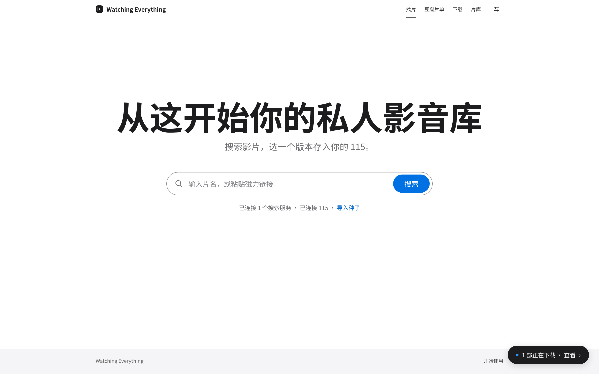
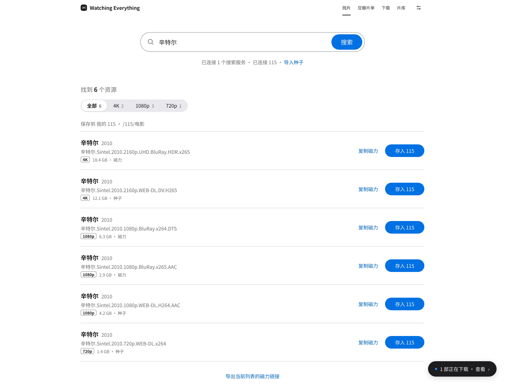
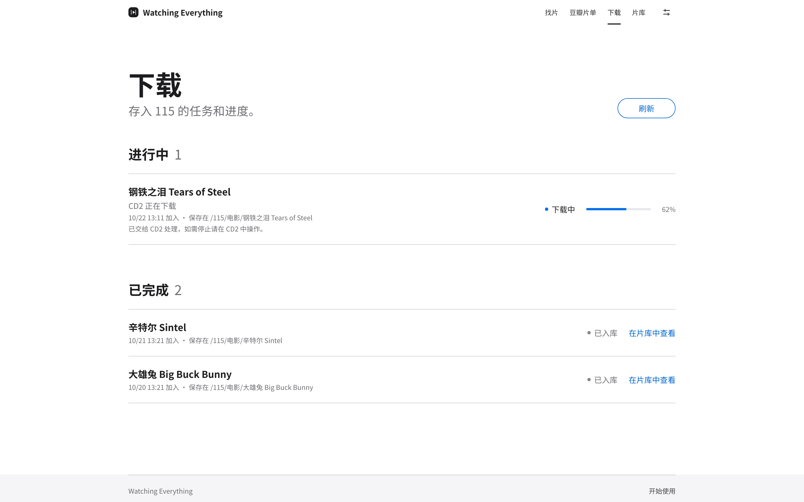
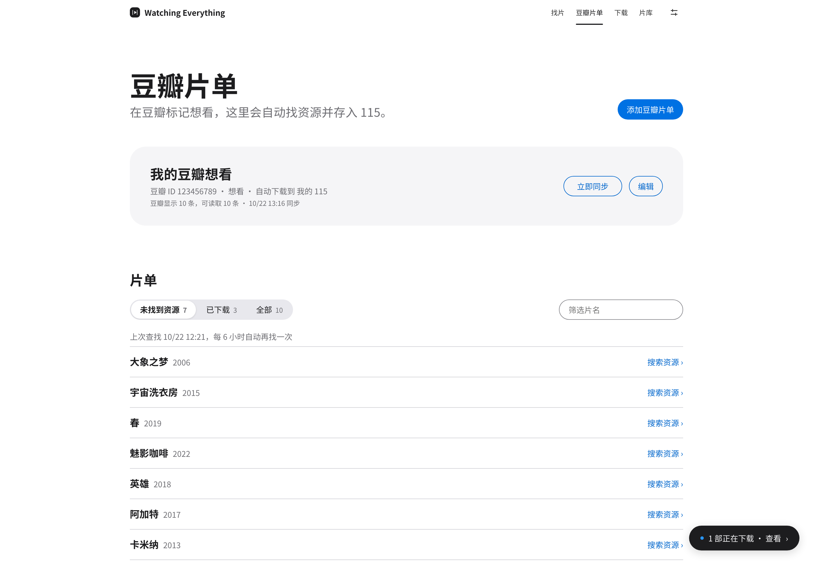
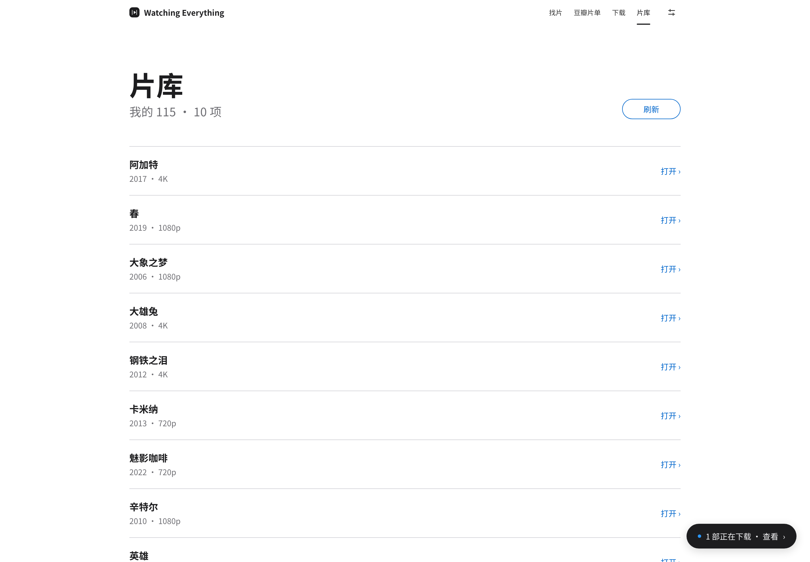
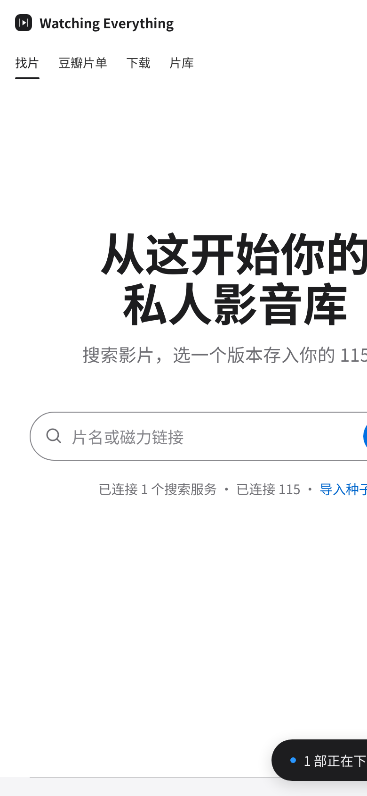

<div align="center">
  
  <h1>Watching Everything</h1>
  <p><strong>从这开始你的私人影音库</strong></p>
  <p>搜片、存入自己的 115、看下载进度、浏览片库，豆瓣标记想看自动下载。<br>本地运行，账号和资源都是你自己的。</p>
</div>

```bash
curl -fsSL https://raw.githubusercontent.com/Mukicheung/cinebridge/main/scripts/install.sh | bash
```

<p align="center"></p>

## 一眼看完

<table>
  <tr>
    <td width="50%"><br><sub><b>找片</b> · 按画质筛选，一键存入 115</sub></td>
    <td width="50%"><br><sub><b>下载</b> · 进度、失败处理、入库验证</sub></td>
  </tr>
  <tr>
    <td width="50%"><br><sub><b>豆瓣片单</b> · 标记想看，自动找资源下载</sub></td>
    <td width="50%"><br><sub><b>片库</b> · 浏览 115 里的影片，文件名自动整理</sub></td>
  </tr>
</table>

<p align="center"><br><sub>手机上同样好用</sub></p>

<sub>截图使用 Blender 开源电影作为演示数据。</sub>

## 介绍

Watching Everything 把你自己的豆瓣公开片单、资源目录、CloudDrive2 和 115 串起来：搜片、列出候选、导出磁力、提交离线下载，再验证入库。开源包不附带资源来源、共享令牌或账号；115 在你自己的 CD2 中登录，本服务不接收 115 密码。

命令行与包名仍为 `cinebridge`：Python 包、CLI 命令、Docker 镜像与 compose 服务名、`CINEBRIDGE_*` 环境变量均未改名，已有部署无需调整。

**v0.3.0** 全新界面：苹果官网式简洁设计、思源黑体、流畅不闪烁的动效；搜索按影片分组、可取消；片单默认只看还没找到资源的；片库自动整理文件名；下载页按「需要处理 / 进行中 / 已完成」分组；豆瓣片单海报接口；手机端适配。

## 可以做什么

- 打开即用的 Web：找片、豆瓣片单、下载、片库、设置。
- CLI 与 Web 共用后端，支持 JSON 输出，适合脚本和 Agent。
- AList 兼容目录搜索、JSON 资源目录、`.torrent` / 磁力导入。
- 只搜索、列种子、复制或导出磁力，无需配置下载器。
- 使用用户授权的 CD2 API 令牌向 CD2 已连接的 115 提交离线任务。
- 持久队列、资源哈希去重、重启恢复、提交结果不确定时核对远端。
- 豆瓣想看 / 在看 / 看过公开片单，完整分页与首次历史基线。
- 新增条目自动匹配，待找资源每 6 小时补找。
- 为每项任务创建独立目录；下载完成后验证媒体文件，才标记入库。
- 浏览 CD2 中已有的 115 片库目录。
- 第三方连接配置加密保存，令牌不回传页面，无外部字体、CDN 或遥测。

## 一键本地部署

准备 Docker Engine + Compose v2，或 Docker Desktop，然后运行上面那一行命令。默认安装到 `~/cinebridge`，启动后打开 **http://127.0.0.1:8766**。

也可以先下载并审阅安装脚本。取得项目后，在项目目录运行：

```bash
bash scripts/install.sh
```

脚本构建并启动容器，等待健康检查，然后显示本机地址，打开即可使用。默认只监听 `127.0.0.1:8766`。如端口已占用：

```bash
CINEBRIDGE_PORT=8877 bash scripts/install.sh
```

也可以直接：

```bash
docker compose up -d --build --wait
```

打开 **http://127.0.0.1:8766**，本地版无需登录。

安装脚本默认从公开仓库 `Mukicheung/cinebridge` 获取代码。Fork 使用者可以通过 `CINEBRIDGE_REPO=owner/repo` 覆盖仓库地址；此设置仅用于安装，不是资源或下载接口。

### 首次配置

1. **检索**：首次打开进入三步引导，导入独立授权 JSON 文件。也可手动连接自己的 AList 兼容服务（需要搜索索引）、JSON 目录或直接导入磁力。保存后点击“测试连接”。
2. **CD2 / 115**：在自己的 CD2 中登录 115，创建入库根目录，并生成具有目录读取、创建文件夹、离线下载及任务查询权限的 API 令牌。在 Watching Everything 填写 CD2 地址、令牌和完整云盘路径。
3. **搜片**：搜索片名，查看候选资源。仅有一个下载连接时会自动选择，点「存入 115」即可；也可以按画质筛选、只复制或导出磁力。
4. **豆瓣订阅**：填写豆瓣用户 ID，选择公开片单。默认首次只建基线，不下载全部历史。自动下载需要单独勾选并选择下载连接。

豆瓣按公开页面同步。若页面标注数量大于实际可见数量，界面会分别显示；确认已走完分页后建立公开可见基线。随后重新出现的历史条目不会自动下载；日期缺失或与首次同步同日的条目显示“等待核对”，可点击“找资源”手动选择。验证码、分页中断仍会停止同步。

CD2 与本服务在同一台 Docker Desktop 主机时，可用 `http://host.docker.internal:19798`（端口以你自己的 CD2 为准）。容器里的 `localhost` 指容器自身。本服务不安装、分发或替你激活 CD2，也不挂载宿主机文件系统。

## CLI

容器内已提供 CLI，将 `cinebridge` 替换为 `docker compose exec -T cinebridge cinebridge` 即可运行。

```bash
cinebridge status --json
cinebridge connections --json
cinebridge connections import ./client.json --json
cinebridge connections add --kind alist --name "我的目录" --endpoint https://catalog.example --root /Films
cinebridge connections add --kind cd2 --name "我的 CD2" --endpoint http://localhost:19798 --root /115/Movies
cinebridge connections test CONNECTION_ID
cinebridge search "电影名称" --json
cinebridge import --title "我的影片 2026" --torrent ./my-film.torrent
cinebridge download RESOURCE_ID --to CONNECTION_ID
cinebridge tasks --json
cinebridge library --json
cinebridge export "电影名称" > magnets.txt
cinebridge subscriptions add --name "我的片单" --user DOUBAN_USER_ID
cinebridge subscriptions sync SUBSCRIPTION_ID
cinebridge watchlist --json
```

添加连接时交互输入第三方令牌，避免写进命令历史。脚本调用可使用 `--token-file`；无令牌的公开 JSON 目录使用 `--no-token`。

客户端默认访问 `http://127.0.0.1:8766`，可设置 `CINEBRIDGE_URL`。本地 CLI 无需访问密钥，也无需读取服务端数据目录。

### Python 本地运行

macOS / Linux，Python 3.11+：

```bash
python3 -m venv .venv
. .venv/bin/activate
pip install -r requirements.lock
pip install --no-deps .
cinebridge serve
```

打开页面即可使用，无需登录。Windows 请使用 Docker；当前单实例锁使用 POSIX 文件锁。

## JSON 资源目录

配置指向用户自己托管的 JSON 文件，最大 8 MiB / 10000 条。例如：

```json
{
  "items": [
    {
      "title": "Your Film",
      "year": 2026,
      "resolution": 1080,
      "size": 1073741824,
      "magnet": "magnet:?xt=urn:btih:0123456789abcdef0123456789abcdef01234567"
    }
  ]
}
```

以上哈希仅示意，不代表可下载资源。`size` 是媒体字节数；AList 搜索得到的种子文件大小不会冒充电影大小。

## 状态与默认规则

`等待提交 → 提交中 → 已提交 / 下载中 → 验证文件中 → 已入库`

- 提交不等于下载完成；完成需 CD2 任务成功和任务目录中的媒体文件证据。
- 重启前正在提交的任务进入待核对状态，禁止自动重复提交。
- 同一下载连接按 BTIH 哈希持久去重。
- 下载目录为 `根目录/影片名称 [哈希前缀]/`，不会自动改名或删除已有文件。
- 自动匹配采用规范化片名精确匹配；有年份时必须一致。优先非原盘，再按清晰度排序。
- 豆瓣每 10 分钟检查一次，分页有数量/结构异常或验证码时不更新基线。
- 失败任务可在处理 CD2 失败记录后手动重试；不确定提交必须先确认远端没有此任务，再点击“核对后重试”或使用 CLI 的 `--confirm-not-submitted`。

## 数据与升级

Docker 数据在命名卷 `cinebridge-data` 中，包括 SQLite、加密主密钥和访问密钥。Python 默认目录为 `~/.local/share/cinebridge`，可用 `CINEBRIDGE_DATA` 修改。

备份时先停止服务，完整备份数据卷；**数据库和 `master.key` 必须一起保存**。丢失主密钥无法恢复连接凭据。升级先备份，再拉取代码、重建容器。普通 `docker compose down` 保留卷；不要使用 `down -v` 删除你的数据。

这是单用户、单进程、可信本地部署工具。默认不开放公网。需要远程访问时，部署者应自行配置 HTTPS 和额外访问控制。连接器由管理员配置，可以访问局域网服务，因此不要直接暴露给不可信网络。

## 当前边界

- 115 通过 CD2 接入，尚未提供独立 115 OAuth 连接器。
- 豆瓣是公开片单的单向同步，不保证第三方页面永久可访问，不绕过验证码或反爬限制。
- 暂不含 TMDB 元数据刮削、剧集逐集追更、通知推送、用户自定义排序、容量迁移与自动清理。
- 文件验证证明任务成功且媒体文件存在，不执行全文件下载/解码或完整性校验。
- BT v1 和混合种子支持；纯 v2 种子暂不支持。
- 网盘离线额度、账号权益、第三方 API 与 CD2 版本仍影响实际下载结果。

使用自己有权访问的资源。项目不包含、提供或销售影视资源。

## 开发

```bash
pip install -e '.[dev]'
pytest -q
ruff check cinebridge tests
node --check cinebridge/static/app.js
```

[架构与扩展](docs/ARCHITECTURE.md) · [协议来源](docs/PROTOCOLS.md) · [安全说明](SECURITY.md) · [贡献指南](CONTRIBUTING.md)

Apache-2.0。公开核心允许修改与分发；不包含任何私人后端、旧系统代码或账号数据。

### 从旧版升级

保留原项目目录和 Docker 数据卷，先备份数据再更新：

```bash
docker compose exec -T cinebridge python -c "import sqlite3; s=sqlite3.connect('/data/cinebridge.db'); d=sqlite3.connect('/data/upgrade-backup.db'); s.backup(d); d.close()"
git fetch origin --tags
git checkout v0.3.0
docker compose up -d --build --wait
```

备份时同时保存 `/data/master.key`，数据库中的连接凭据需要它解密。升级不会自动启用历史下载；原有片单和任务继续保留。不要使用 `docker compose down -v` 删除数据卷。
